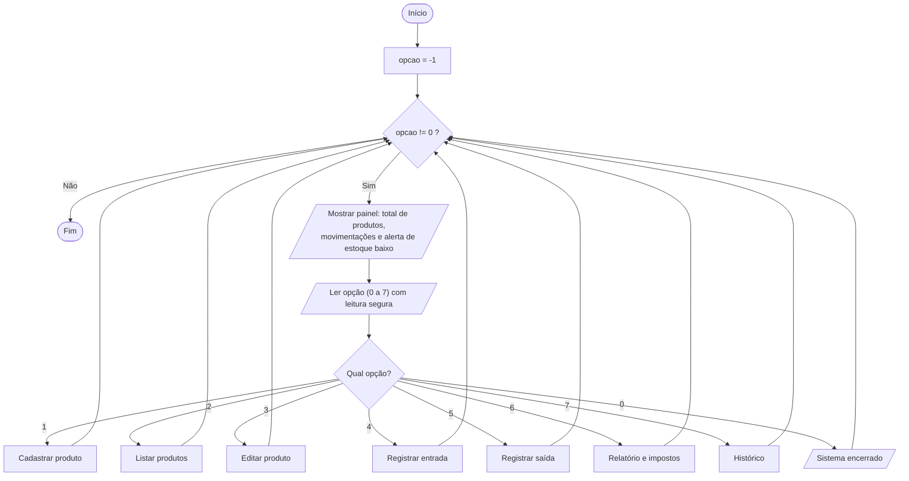
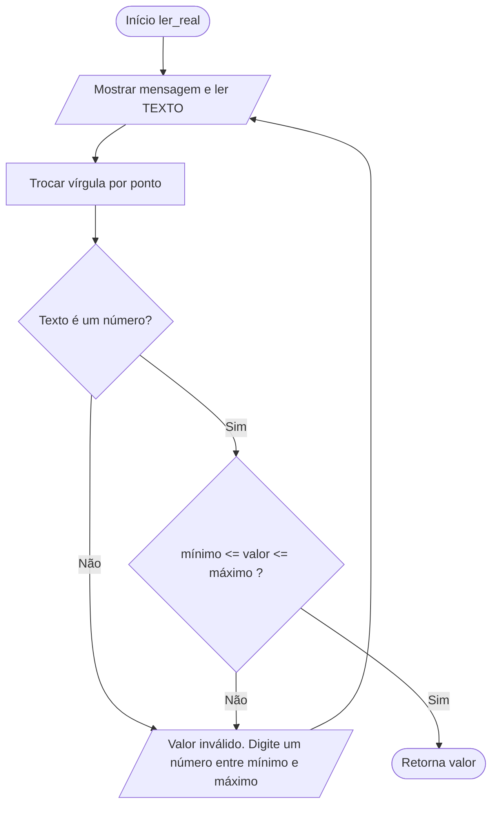
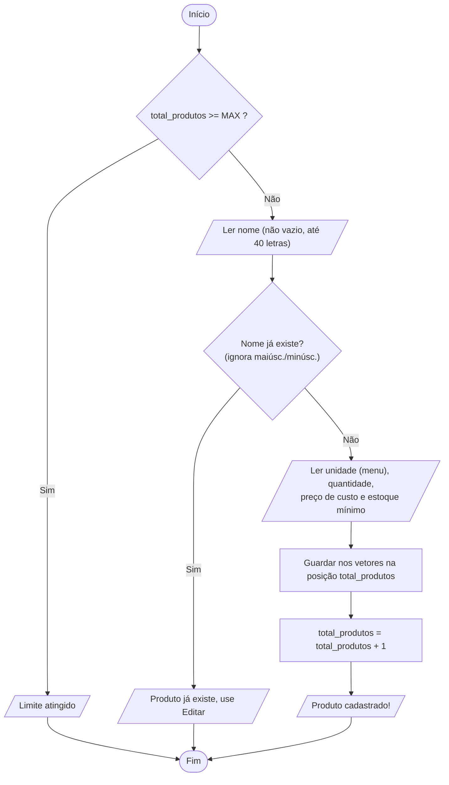
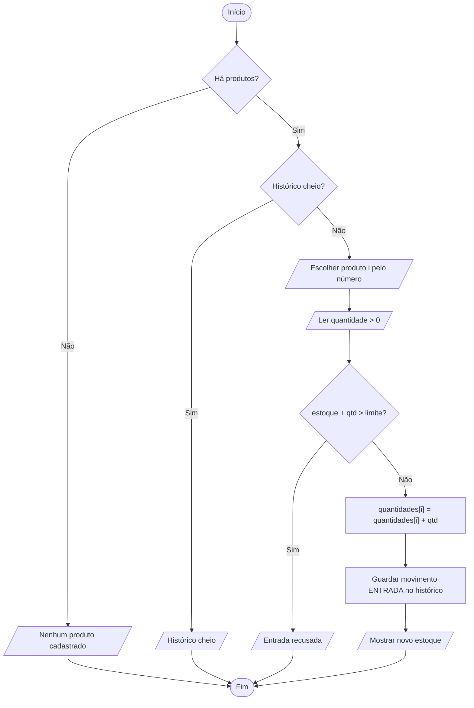
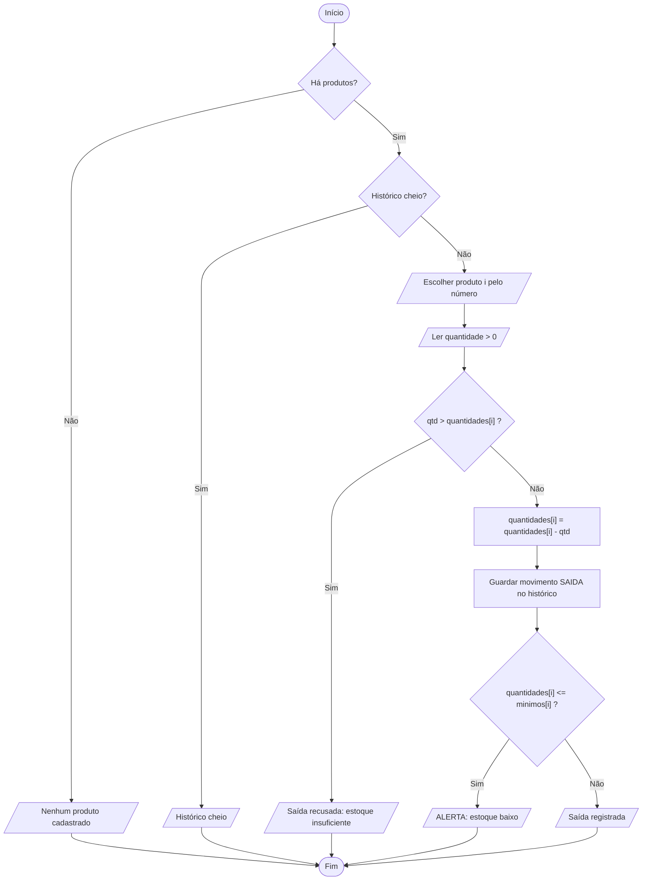
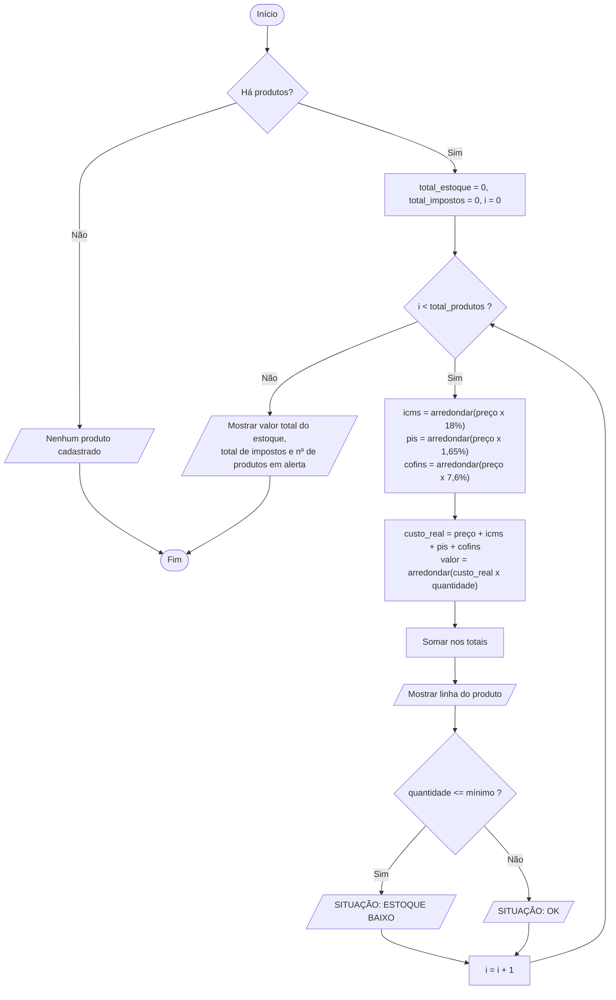

# Fluxograma — Estoque Tributável da Pizzaria (RASCUNHO da IA)

> Rascunho para estudo. Passe para a ferramenta que o professor pede, desenhando você mesmo.
> Para ver o desenho: cole cada bloco em https://mermaid.live
>
> Símbolos: `([ ])` = início/fim · `[ ]` = processo · `{ }` = decisão · `[/ /]` = entrada/saída de dados

## 1. Programa principal (menu)

## 2. Leitura segura de número (não deixa o sistema travar)

## 3. Cadastrar produto

## 4. Registrar entrada (compra)

## 5. Registrar saída (uso/venda)

## 6. Relatório com impostos

